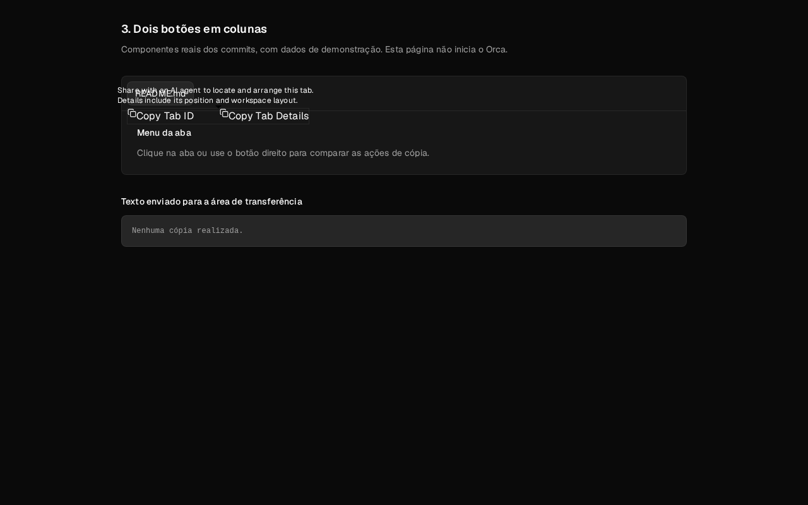
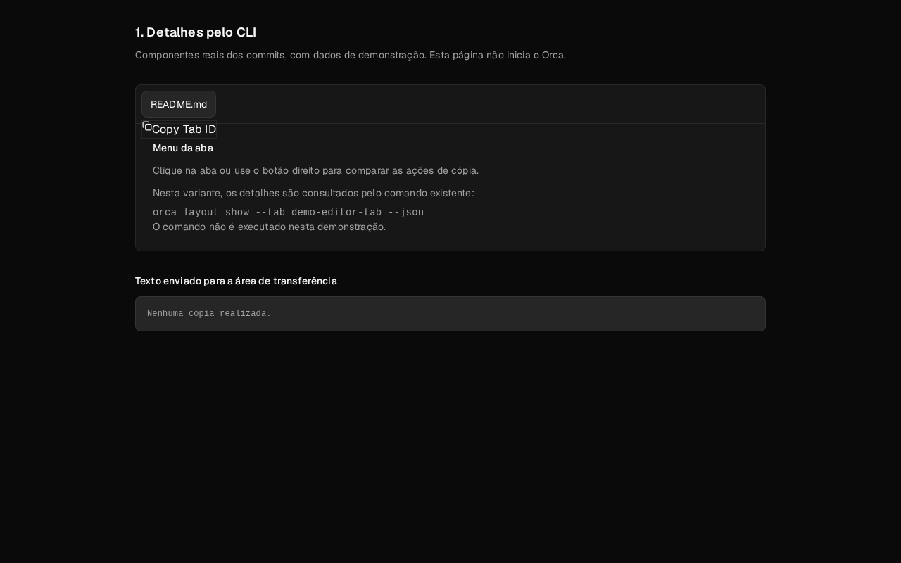
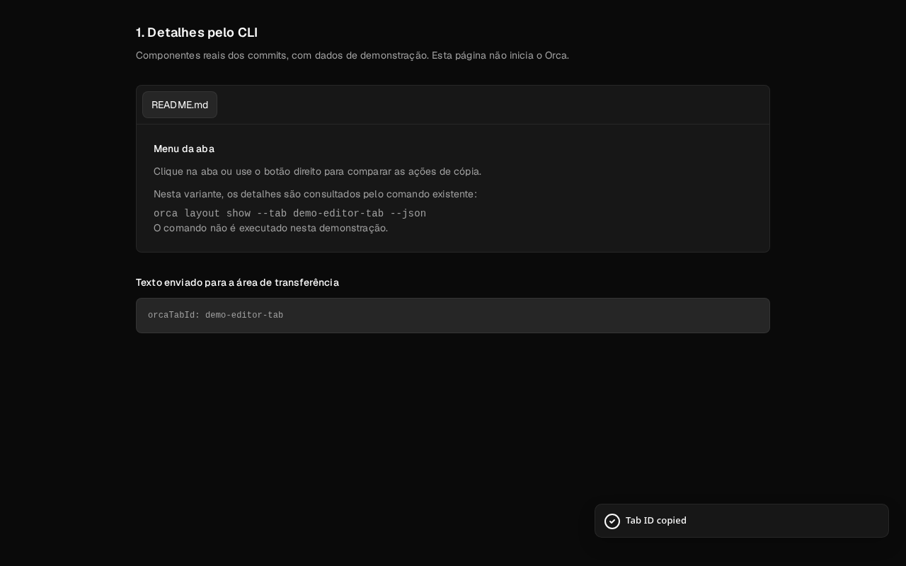
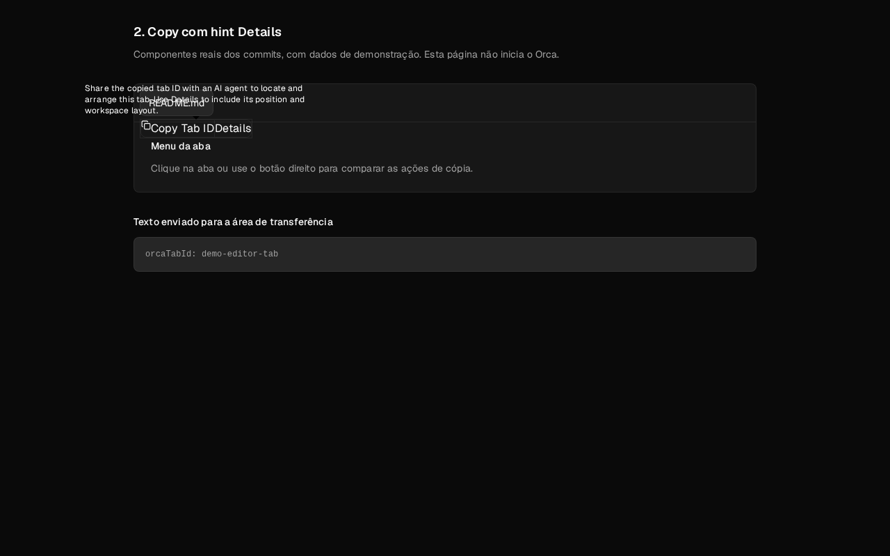
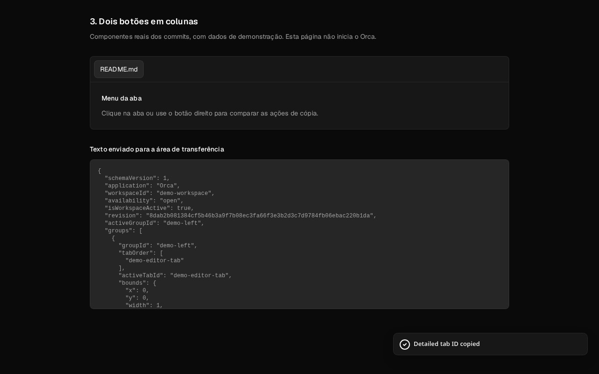

# Orca Review Changes

A **Vue 3 + Vite** website that turns automated Orca test recordings into shareable evidence pages: screenshots and video, what the assertions checked, and what remains unverified, each linked to the relevant PR, commit or issue. It also ships an **MCP server**, so an agent can record tests, search reviews and save evidence directly.

[](docs/screenshots/two-columns-menu.png)

**[View the website](https://fabricedge.github.io/orca-change-review/)** · [Recording guide](docs/test-recording.md) · [MCP setup](docs/mcp.md) · [Deployment guide](docs/github-pages.md)

Created by: [fabricedge](https://github.com/fabricedge)

> Evidence pages support code review. They do not replace proper review of the GitHub PR, its code, tests or CI results. A video alone does not prove that a test passed.

## Screenshots

Captured from the real Orca app with hidden renderers (`ORCA_BACKGROUND_LAUNCH=1`). Click a thumbnail to open the full-size PNG.

| Variant | Menu | Tooltip | Copied |
| --- | --- | --- | --- |
| **CLI only** | [](docs/screenshots/cli-only-menu.png) | — | [](docs/screenshots/cli-only-copied.png) |
| **Split control** | [](docs/screenshots/split-control-menu.png) | [](docs/screenshots/split-control-tooltip.png) | [](docs/screenshots/split-control-copied.png) |
| **Two columns** | [](docs/screenshots/two-columns-menu.png) | [](docs/screenshots/two-columns-tooltip.png) | [](docs/screenshots/two-columns-copied.png) |

These come from the [three-variant tab-copy demonstration](#three-variant-tab-copy-demonstration).

## Purpose

Orca Review Changes gives developers a place to publish automated videos of the real Orca app alongside descriptions, test outcomes and coverage limits. Use a page to explain a feature, demonstrate a regression or share evidence from a specific test run.

The local MCP runs tests and records the app on the developer's execution host. GitHub Releases stores reviewed videos. GitHub Pages serves the generated website; it does not run the MCP or Electron tests.

## Workflow

1. Select an Orca Electron E2E spec for the feature or regression.
2. Record the real app and inspect the video and test report.
3. Describe the observed behavior, assertions, outcome and limitations.
4. Save the evidence against a PR, commit or issue.
5. Upload reviewed videos to Releases and publish the evidence page through Pages.

Failed and incomplete results must remain clearly labeled. Do not infer a passing test from a video or a successful build alone.

## Create your own Orca Review

1. Fork this repository and clone your fork.
2. Install Node.js 24 or later. Run `npm ci` when your clone includes a lockfile, or `npm install` for a fresh installation without one.
3. Replace the examples in `lib/revisions.mjs`, or use MCP to add records to `data/reviews.json`. See [adding changes](docs/adding-changes.md).
4. Set `NEXT_PUBLIC_SITE_REPOSITORY=your-username/your-repository` in `.env.local` for previews. The topbar derives the owner and source links from this value. The Pages workflow sets it automatically.
5. Update the website and author links in this README for your fork. Remove the example `media/releases.json` before importing your own recordings.
6. Enable **Settings → Pages → Build and deployment → GitHub Actions** and push to `main`.

Keep `createdAt` unchanged when editing a page and update `updatedAt` when its content changes. Use ISO 8601 datetimes with a timezone. Dates describe the evidence pages, not PR creation or deployment times, and display in UTC. Site-level dates live in `lib/review-site.mjs`.

## Local development

```sh
npm run dev
```

The development server listens on `0.0.0.0:3100`. For a local production server, run `npm run build`, then `npm start`. A Pages export is hosted by GitHub Pages instead of `npm start`.

| Route              | Content                                            |
| ------------------ | -------------------------------------------------- |
| `/revisoes/`       | Evidence and review catalog; currently Portuguese. |
| `/revisoes/SLUG/`  | Individual review or evidence page.                |
| `/en/tab-copy/`    | English comparison of three tab-copy alternatives. |
| `/pt-BR/tab-copy/` | Portuguese comparison of the same alternatives.    |
| `/en/workflow/`    | English test recording, MCP and issue guidance.    |
| `/pt-BR/workflow/` | Portuguese workflow guidance.                      |

The root opens the English documentation index. Original record text keeps its source language; navigation and workflow guidance are available in English and Portuguese. Language switching preserves branch names, commit IDs and recorded video content.

For Tailscale access, keep the server running and open `http://YOUR-TAILSCALE-IP:3100` from another device on the tailnet. Find the IP with `tailscale ip -4`. An HTTPS alternative is:

```sh
tailscale serve --bg --https=8444 http://127.0.0.1:3100
```

Use the URL printed by Tailscale. The site has no application-level authentication.

## MCP integration

```sh
npm --prefix mcp install
npm --prefix mcp run smoke
```

The smoke command checks stdio connection and tool discovery; it does not launch a recording. Configure your client to run `node` with the absolute path to `mcp/server.mjs`. Set `ORCA_REVIEW_TARGET` to the target Orca checkout.

| Tool               | Purpose                                                                                  |
| ------------------ | ---------------------------------------------------------------------------------------- |
| `record_orca_test` | Record one existing Orca Electron E2E spec, or validate its plan with `checkOnly: true`. |
| `get_recording`    | Retrieve execution state, test outcome, report counts and video paths.                   |
| `list_reviews`     | Search recorded reviews.                                                                 |
| `get_review`       | Read a review's text, evidence and source references.                                    |
| `save_review`      | Save a local review, optionally attaching a completed capture and published video URLs.  |
| `issue_guidance`   | Read contribution rules and issue templates from the configured checkout.                |

Recording reuses Orca's test configuration and recording-capable Electron fixture, rebuilds the app and captures hidden renderers with `ORCA_BACKGROUND_LAUNCH=1` and `ORCA_E2E_HEADLESS=1`. Visible-window and native-focus tests are excluded. Run MCP on the host containing the checkout and review data, including for SSH development.

Follow the [MCP setup guide](docs/mcp.md) and [recording guide](docs/test-recording.md) for prerequisites, publication steps and limitations.

## Deploy to GitHub Pages

Commit and push the reviewed website source and `data/reviews.json` to `main`. Follow **Deploy GitHub Pages** in Actions, then open the URL reported by the deployment job. The workflow validates the catalog, pre-renders Vue articles with the repository base path and checks the generated routes. Use published Release URLs for videos; local recordings are not available to the GitHub-hosted build.

For the original Orca checkout and its sibling installation, run:

```sh
bash /home/katrina/projects/orca/artifacts/deploy-orca-pages.sh
```

This script updates the installed website, validates the build, commits and pushes the changes, starts the deployment and waits for its result. It does not automatically publish new generic test recordings. See the [deployment guide](docs/github-pages.md).

To check a static export on Linux/macOS:

```sh
ORCA_GITHUB_PAGES=1 NEXT_PUBLIC_BASE_PATH=/your-repository npm run build
```

On Windows, set those environment variables in your shell before running the build.

### Repository description and website link

The repository's About section should use this description:

> Vue 3 + Vite site that turns automated Orca test recordings into evidence pages with screenshots and video, linked to PRs, commits and issues. Ships an MCP server for agents. Created by: fabricedge.

Set its Website field to `https://fabricedge.github.io/orca-change-review/`. The included script applies both fields with an authenticated GitHub CLI:

```sh
bash scripts/update-repository-about.sh
```

For a fork, pass your repository, Pages URL and author as its three arguments.

## Three-variant tab-copy demonstration

The specialized recorder builds separate CLI-only, Details-hint and two-column alternatives:

```sh
npm run record:orca
npm run import:orca
npm run dev
```

It creates temporary clones from the local variant bundle, installs dependencies, builds each app and records the full Orca UI with disposable profiles and projects. The CLI-only video shows its menu; it does not execute the CLI inspection command.

Requirements include Node.js 24, Git, pnpm, Electron system dependencies, registry access and sufficient temporary disk space. On Linux, provide a graphical session or an isolated Xvfb display. To validate the bundle and base commit without launching apps:

```sh
npm run record:orca -- --check
```

Before artifact migration, output lives under `ORCA_SOURCE/artifacts/tab-copy-prs/images/videos`; after migration, it lives under the review installation's `orca-artifacts/tab-copy-prs/images/videos`. Failed runs preserve prior complete recordings and report temporary directories for diagnosis.

The importer requires `capture.json` to identify a full `orca-app` recording. A tracked Release manifest takes precedence over local imports. Importing media does not upload it or replace Release assets. See the [Releases guide](docs/github-releases.md) for this specialized demonstration and the [recording guide](docs/test-recording.md) for other specs.

## Issues as supporting context

When a test exposes a problem, describe the actual user goal, observed behavior, expected result and workflow impact. Read the target repository's current issue guidelines and search for duplicates. Keep the problem separate from a proposed solution.

A local issue draft does not require a PR or commit and is not a published issue. Keep one user problem per issue; separate unrelated work rather than growing one PR indefinitely. The project's main purpose remains test and feature evidence.

## Update the original sibling installation

Before artifact migration, the prepared source lives in `orca/artifacts/orca-changes-stuff`; the sibling `../orca-changes-stuff` is its installation. Update it with:

```sh
node /home/katrina/projects/orca/artifacts/install-orca-changes-stuff.mjs --update-site
```

The updater validates in a temporary directory, backs up replaced files and preserves developer records, local environment files and media. Add `--check-only` to validate without applying changes. Restart the server afterward. Reinstall MCP dependencies if its directory was replaced.

In a fork of the review repository, edit your clone directly; these original-checkout installer paths are not required.

## Suggested Pages improvements

These are proposed improvements, not features already implemented:

1. **Lead with the evidence catalog.** Show recent test runs, outcomes and related PRs or commits instead of opening the historical tab-copy comparison.
2. **Preserve a page per execution.** Keep failed runs and earlier successful runs accessible with their tested commit and local-change state.
3. **Complete English routes and translations.** Localize the catalog and detail pages while preserving existing links through aliases or redirects.
4. **Make videos easier to inspect.** Add posters, test-step chapters and captions or transcripts, explaining which assertions each segment supports.
5. **Filter by result and context.** Add outcome, platform, feature, PR and commit filters. Keep report results distinct from author-written descriptions.
6. **Check published evidence links.** Verify expected video assets and page URLs before declaring deployment complete; report broken references clearly.
7. **Generate a PR evidence summary.** Provide a copyable page link with the observed behavior, result and coverage limits, including the code-review reminder.

## Validation and known limits

Static export, focused lint and regression checks for catalog validation, update safety, MCP handlers, recording plans and outcome classification passed in the development environment. A temporary fixture verified rendering of a failed test, its video link and the review disclaimer.

A new real Electron recording through this MCP integration still needs validation. The sandbox returned EOF on child-process stdin, preventing validation of the stdio handshake there; run the smoke command outside that environment. Existing videos do not establish that the new integration works end to end. See [MCP limitations](docs/mcp.md) and [previous website validation](docs/melhorias-funcionais.md).

### Catalog and source references

The catalog supports a shareable search, change type and recorded test outcome, with sorting by update date or title. A video without a recorded test result is never labeled as passed. Each entry shows every registered PR, issue and commit, and its last update date.

Use `repository: "owner/repository"` for a published GitHub repository, `pullRequest` and `issue` for full HTTPS links, and `commits: [{ "id": "abcdef0", "label": "Describe the change" }]`. Commit links are generated from that repository. For local branches, omit `repository` until the commits are published; the site displays their IDs with an explicit publication notice rather than sending readers to broken links. Publish the branch, confirm each commit exists on the remote, then update the review and rebuild Pages.

The shared navigation explains the evidence catalog, the tab-copy comparison and the MCP recording workflow. It also links to this repository and the instructions for creating your own review site.

### Open a local preview from the topbar

Choose **Check locally**, enter your localhost URL and port (default `http://localhost:3100`), or enter a Tailscale IP or full HTTP/HTTPS link, including the port when needed. Select your preferred connection and click **Save preference**, then **Open**. Addresses and the selected connection stay in this browser’s local storage; you can edit them at any time. They are not published to the repository or shared with other visitors.

Localhost refers to the device viewing the page. From your phone, use the development computer’s Tailscale address instead. Start the server on that computer and make it reachable through Tailscale. The website opens the address you provide; it does not start the server or verify connectivity.

## Development and automation

- [Local deployment, ports and Tailscale](docs/local-development.md)
- [Use MCP after a feature, fix or investigation](docs/automation.md)
- [Contributing](CONTRIBUTING.md)
- [Versioning and release process](docs/releases.md)
- [Changelog](CHANGELOG.md)

Run `npm run deploy:local` for a local preview. Version the site and MCP together with `npm run version:set -- 0.2.0`. After-change recording is opt-in and uses the same MCP tools as your agent; see the automation guide before enabling it in a task runner.

## Website and README presentation

The default presentation is a light technical wiki with persistent navigation, compact change lists, permanent articles and a contextual table of contents.

Choose **README mode** under **Tools & local preview** for a compact document layout with the same videos, source references and tools. Choose **Wiki mode** to restore the documentation layout. The selection persists in this browser across pages and visits, and is applied before hydration to reduce visual flashing. If browser storage is blocked, switching still works for the current page.

## Catalog and topics

The default homepage is `/en/overview/`, with a Portuguese edition at `/pt-BR/overview/`. `/en/news/` remains the recent-changes page. Legacy `/revisoes/` and article links remain available. Each record links its stored PRs, commits and evidence; provider status is not polled automatically.

Set optional `topic` in a review, including MCP `save_review` payloads. Existing topics are `tabs-layout` and `remote-services`; custom topic names are supported. Unclassified changes appear under Development. Sidebar topic links use the real catalog filters.

## Technical wiki architecture

The website uses Vue 3, Vue Router and Vite. `src/components` holds the shared navigation, article sections, source references, revision history, comparison and local review controls. `lib/revisions.mjs` and `data/reviews.json` remain the record catalog shared with the MCP. Existing Portuguese record text is preserved; navigation and workflow guidance support English and Portuguese.

`npm run build` renders every known article to its own HTML file in `out`. GitHub Pages serves those files directly, including legacy `/revisoes/` URLs, without a server or rewrite rules. `NEXT_PUBLIC_BASE_PATH` remains supported for existing deployments. Search and filters run against the same real catalog in the browser; a rebuild publishes newly saved MCP records.

The source does not store historical diffs or commit dates. Revision history shows the actual record timestamps and keeps recorded commit identifiers, without inventing prior versions. Videos are shown only when their manifest identifies a full Orca app capture.

Validation: `npm test`, `npm --prefix mcp test`, `npm run check:changes`, `npm run build`, and `node scripts/check-pages-export.mjs`. See [migration and validation notes](docs/vue-migration.md).

## License

Released under the [MIT License](LICENSE).

## ASTTSP comparisons

PRs that offer alternative solutions to the same problem can share an **ASTTSP** tag. Browse `/en/asttsp/` or read [how to register groups and tag future PRs](docs/asttsp.md).
